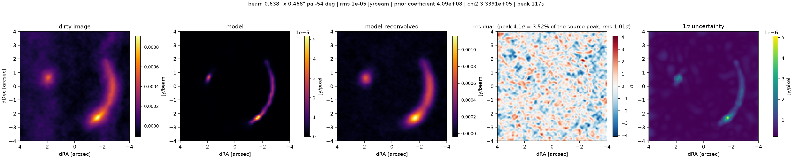

# pyuvimage

Easy image reconstruction of radio interferometric data by **forward modelling
in the uv-plane**. A lightweight alternative to CLEAN producing a
regularised maximum-likelihood image without heavy compute.

Built using [PyAutoGalaxy](https://github.com/PyAutoLabs/PyAutoGalaxy) and [PyAutoArray](https://github.com/PyAutoLabs/PyAutoArray)
tools: the sky is a freeform image on a
cartesian grid, solved by a linear inversion under a Gaussian-process source
prior whose hyperparameters are optimised automatically.

## Install

```bash
pip install -e .            # core (numpy backend; numba and autoarray >= 2026.10.2.1, see docs/install.md)
pip install -e ".[ms]"      # + python-casacore, to read measurement sets
pip install -e ".[jax]"     # + JAX/nufftax (optional)
pip install -e ".[mask]"    # + regions, to read CASA/DS9 region files for --mask
```

Python ≥ 3.12. JAX is optional and the NumPy path is fully supported, but becomes increasingly memory intensive above ~5000 visibilities. JAX is **strongly** recommended for larger data sets. See [docs/install.md](docs/install.md),
which also covers building an **arm64** conda environment on Apple silicon.

## Use

```bash
# one-off: convert the measurement set (calibrated data, one field)
pyuvimage import obs.ms mydata/            # spw 0
pyuvimage import obs.ms mydata/ --spw all  # or every spectral window

# reconstruct — fov must cover ALL the emission in the field
pyuvimage fit mydata/ --fov 3.0
```

No python-casacore? Export from CASA with the bundled script and fit the `.npz`
directly:

```bash
# field 0, spw 0; spw may also be a list (0,2), a range (0-3), or "all"
casa --nologger --nogui -c src/pyuvimage/casa_export.py obs.ms mydata.npz 0 all
pyuvimage fit mydata.npz --fov 3.0
```

Or from Python:

```python
import pyuvimage
result = pyuvimage.run("mydata/", fov=3.0, mode="cube")  # or "mfs" (default)
```

Try it with no data at all: `pyuvimage demo`.

## Outputs

All FITS, all on one grid at one pixel scale, WCS from the MS phase centre.

| file | unit | content |
|---|---|---|
| `model.fits` | Jy/pixel | the reconstructed sky (apparent, i.e. PB-attenuated) |
| `model_pbcor.fits` | Jy/pixel | primary-beam-corrected model |
| `model_reconvolved.fits` | Jy/beam | model ⊗ fitted Gaussian beam + residuals — the CLEAN-image analogue |
| `model_reconvolved_pbcor.fits` | Jy/beam | primary-beam-corrected version of it |
| `residual.fits` | σ | (data − model) dirty image / rms (rms in header `RMS`) |
| `uncertainty.fits` | Jy/pixel | 1σ per pixel, of the kind `--uncertainty` asked for (`ERRTYPE`) — see below; not written by default. `uncertainty_pbcor.fits` is the PB-corrected version |
| `model_bayesian.fits` | Jy/pixel | `--uncertainty bayesian`: the posterior mean marginalised over the prior strength, which `uncertainty.fits` is then the 1σ of |
| `snr.fits` | — | S/N at the restoring beam's resolution: the model convolved with the beam over its own 1σ (from the full covariance), points included |
| `posterior_samples.npz` | Jy/pixel | `--posterior-samples N`: N draws from the posterior per channel, as offsets from `model.fits` — read with `pyuvimage.posterior.PosteriorSamples` |
| `dirty_image.fits` | Jy/beam | naturally weighted dirty image of the data |
| `dirty_model.fits` | Jy/beam | dirty image of the model visibilities |
| `pb.fits` | — | primary beam (Gaussian, FWHM ≈ 1.13 λ/D), centred on the phase centre — not on the image centre when `--image-centre` is used |

Plus `summary.png`, `input_parameters.json` (what the run was asked to do,
written as it starts -- `pyuvimage fit --config input_parameters.json` repeats
it), `fit_parameters.json` (what those inputs resolved to), `prior_scan.json`
(every hyperparameter trial), and `point_sources.json` when point components
are fitted.



J0209 (9io9) at 135 GHz, an ALMA Band 4 observation of a lensed source
(164,262 visibility samples across four spectral windows, `pyuvimage fit
9io9_135GHz_cont.npz --fov 8`): the arc and its counter-image
at χ²/N = 1.016 on a 62×62 mesh, a residual peaking at 4.1σ — 3.5% of a 117σ
peak — and a residual map whose rms is 1.01σ with no trace of the source,
which is what you want to see. The run chose the sparse inversion (using JAX), the
`structure` criterion and the adaptive prior for itself. The model panel is in
Jy/pixel and the reconvolved panel in Jy/beam.

## The settings worth knowing about

`--fov` is the only required input; everything else has a default that is meant
to be left alone. These are the ones worth reaching for:

| flag | when |
|---|---|
| `--reg gibbs` | a single bright compact feature you want as sharp as possible |
| `--reg gaussian` | very sparse visibilities, where a stationary prior lets sidelobes leak into the model |
| `--point-sources` | there is a genuine point source in the field — no pixel grid can represent one |
| `--image-centre auto` | the source is not at the phase centre. Recentring on it is exact and cost falls as the *square* of the field you then need |
| `--pixel-scale nyquist` | you want the longest baselines sampled — finer mesh, several times slower, and only worth it if the long baselines are well populated |
| `--criterion structure` | rarely — `auto` already picks this on any well-constrained fit. Force it if the structure ratio the run prints is far from 1 while `chi^2/N` looks fine |
| `--criterion evidence` | the fit looks over-smoothed at a bright peak *and* you have fewer visibilities than model pixels |
| `--inversion dense` | you want the long-established path on a big dataset. `auto` (the default) switches to the sparse w-tilde inversion above 5000 visibilities, which is where the dense mapping matrix starts to dominate — see [Run time and memory](#run-time-and-memory). The sparse path is new; force `dense` if you want to compare |
| `--mask mask.fits` | a bright extended source whose sidelobes the fit absorbs as broad emission across the field — the model is held to zero outside the mask. See [Masks and adaptive meshes](#masks-and-adaptive-meshes) |
| `--mesh-type hilbert` | a compact source in a wide field: mesh points follow the brightness, so far fewer are needed. See [Masks and adaptive meshes](#masks-and-adaptive-meshes) |
| `--mode cube` | per-channel images instead of one MFS image. The shared prior is fitted on every channel's data by default (`--cube-prior mfs`; `channel` fits it on a 1-in-`n_chan` subset; `per-channel` lets each channel choose its own strength, for line cubes) — see [docs/parameters.md](docs/parameters.md#what-the-cubes-shared-prior-is-fitted-on) |

Any of them can also be set in a JSON file instead of on the command line:

```bash
pyuvimage fit --config params.json          # dataset and --fov may be in it
pyuvimage fit --config params.json --fov 12 # the command line still wins
```

[docs/fit-config-template.json](docs/fit-config-template.json) is a template
with every key at its default.

Full reference: [docs/parameters.md](docs/parameters.md).

## Choosing the prior (`--reg`)

The source prior is what stops the inversion fitting noise. All of these are
Gaussian-process priors on the mesh, `H = coefficient × C^-1`; they differ in
whether `C` varies across the image, and how.

| `--reg` | what it is | when to use it |
|---|---|---|
| `adaptive` **(default)** | two-stage: a first-pass model becomes a brightness map, and the prior's *amplitude* follows it as `b^power` | general use — the best extended model, and no central artefact |
| `gibbs` | non-stationary Matérn: the correlation *length* shortens where the source is bright | sharpest on a single compact feature; leaves a central residual on extended sources |
| `matern` | stationary Matérn covariance, correlation length = the synthesised beam | smooth sources, and the fastest — one pass instead of two |
| `gaussian` | `matern` modulated by a Gaussian envelope on the prior width | sparse visibilities, where a stationary prior lets sidelobes leak in |
| `exponential` | `matern` with ν = 0.5 — rougher | when the source has genuine sharp edges |
| `constant` | nearest-neighbour gradient penalty, no covariance | rarely: rank-deficient, and its evidence is ill-behaved |

The strength (`--lambda`) and correlation length (`--scale`) are optimised for
you; `--adapt-power` sets the exponent for `adaptive` and `gibbs`, `--nu` the
Matérn smoothness. Comparisons across three mocks are in
[docs/priors.md](docs/priors.md).

**How the strength is chosen** is `--criterion`, and the default `auto`
decides for you. `structure` drives the residual *map* to the noise level, and it is what you want on any fit where the
visibilities outnumber image pixels. `auto` uses it above 10 data points per mesh pixel and `chi^2 = N`
below (the log says which it used). On three real ALMA datasets spanning
30× in visibility count, `--reg adaptive` at structure ratio 1.0 leaves a peak
residual of 3.9–5.0σ; see [docs/design-notes.md](docs/design-notes.md).

## The uncertainty map

Off by default; `--uncertainty` chooses what it contains:

| mode | `uncertainty.fits` | extra products | cost |
|---|---|---|---|
| `none` (default) | not written (nor `snr.fits`) | — | — |
| `statistical` | posterior width at the fitted prior strength | — | one inverse |
| `bayesian` | posterior marginalised over the prior strength (evidence-weighted) | `model_bayesian.fits` | ~25 unconstrained solves + a few inverses |

**How they are computed, in brief.** The fit is linear with a Gaussian
prior, so the posterior on the model is Gaussian and its covariance is
known in closed form, `C = (F + H)⁻¹`: `F` is how well the data constrain
each pixel, `H` how strongly the prior ties it to its neighbours. Every
error product is this covariance propagated to a quantity:

- `uncertainty.fits`: the 1σ of each image pixel, `sqrt(diag(M C Mᵀ))`.
- `snr.fits`: the model smoothed to the restoring beam, over the 1σ of that
  smoothed model from the same covariance. This is the significance map.
- `source_flux`: the flux in a region, with its error from the covariance.
- `posterior_samples.npz` (`--posterior-samples N`): N draws from the
  posterior, for any other quantity.

Two corrections first: pixels held at zero (a mask's edge, positivity) are
constraints, not parameters, and get no variance; and the covariance is
scaled by χ²/N when the fit cannot reach χ²/N = 1, since the noise map is
then too small. The `bayesian` mode goes one step further: the prior's
strength is itself uncertain, so it averages the posterior over the
strength, weighting each by the evidence. On mocks that brings the fraction
of pixels within 1σ of the truth from 0–58% (`statistical`) to 65–85%
(68% is calibrated). Use `bayesian` whenever the error bars matter, and
always for cubes.

**Three things to avoid.** Do not divide the model by `uncertainty.fits`
for a significance map: on a model sampled finer than the beam neighbouring
pixels are strongly anticorrelated and the ratio reads far too low — use
`snr.fits`. Do not add per-pixel errors in quadrature: they are correlated
over the prior's correlation length — use the region's error
(`source_flux`, or `SingleFit.aperture_uncertainty`). Do not expect either
mode to cover the prior *family* being wrong, or calibration errors.

**Posterior samples** (`--posterior-samples N`) are the general tool:
compute any quantity — a moment map, a line ratio, a flux — on each draw,
and the scatter over draws is its error with every correlation carried
through. This is how to tell what the data say on scales smaller than the
beam: at high S/N the draws agree on that structure, at low S/N they spread
as the prior allows. `scripts/moment_maps.py` turns them into moment-map
error maps.

Details, the checkerboard removal (`ERRDEBL`), and why the earlier
statistical + prior-systematic mode was removed:
[docs/uncertainty.md](docs/uncertainty.md).

## True point sources

A genuine point source cannot be fit by a regularised pixel grid. `--point-sources` instead adds analytic delta components whose
amplitudes are solved **in the same linear system** as the mesh.

```bash
pyuvimage fit mydata/ --fov 3.0 --point-sources     # auto-detect
pyuvimage fit mydata/ --fov 3.0 --point 0.70,0.80   # you supply the position
```

`--point-sources` is deliberately conservative: point source detection is a matched filter over the
whole field, not a residual peak-finder. A candidate must clear a
significance cut *and* be positive, at least 0.75 beams from any other
candidate, and genuinely unresolved. Across the generalisation suite this gave
**zero false positives**. Fluxes and 1σ errors land in `point_sources.json`.

Fitting is refused outright if the pixelized model has not converged to its
chi^2 target, because the residual is then model error rather than sky.


Details: [docs/point-sources.md](docs/point-sources.md).

## Masks and adaptive meshes

Two options change *where* the model can put flux. Both build an irregular
mesh — a Delaunay triangulation of points, interpolated linearly onto the
image — in place of the rectangle, and work with either `--mode`.

### `--mask`: emission only where you allow it

```bash
pyuvimage mask pyuvimage_out/dirty_image.fits --out mask.fits   # paint one
pyuvimage fit mydata/ --fov 35 --mask mask.fits
pyuvimage fit mydata/ --fov 35 --mask galaxy.crtf               # or a region file
```

The mask is a **hard** constraint: mesh points are placed only inside it, and a
ring of points round it is held at zero, so the model is zero outside. It
implies positivity (the zeroed points are enforced by the non-negative
solver).

**Why.** A bright extended source whose integrated flux is far above its peak
brightness turns the few shortest baselines' sidelobes into strong bands
across the dirty image. The data cannot tell those from real broad emission,
so a positive fit absorbs them: on NGC 4274 (0.65 Jy against an 8.7 mJy/beam
peak) an unmasked fit put about half its flux into bands across the field.
With a mask round the galaxy the model holds 0.69 Jy, all in the galaxy, and
the bands are explained as its sidelobes.

**Making one.** A CASA region file (`.crtf`, from the CASA viewer or CARTA) or
DS9 `.reg` file — needs `pip install -e ".[mask]"`; regions prefixed `-` are
cut out — or any FITS image with a celestial WCS, non-zero where emission is
allowed, resampled onto the fit grid. `pyuvimage mask IMAGE` opens
PyAutoGalaxy's painter over an image (a fit's `dirty_image.fits` or a CASA
image): brush `1` adds, `2` erases, `=`/`-` resize, `z` undoes, Esc finishes.
`--start` refines an existing mask or region file. Use `--backend MacOSX` if
TkAgg is unavailable on a Mac.

**Reading the result.** What the mask excludes shows up in the residual, which
is the check that it is not too tight: compact blobs outside it are real
emission it leaves out. The strength criterion measures the residual inside
the mask (dilated by one beam), since outside it holds what the model is
forbidden to fit, and the run reports the residual outside the mask
separately.

### `--mesh-type hilbert`: points that follow the brightness

```bash
pyuvimage fit mydata/ --fov 8 --mesh-type hilbert
pyuvimage fit mydata/ --fov 35 --mesh-type hilbert --mask mask.fits --mesh-points 3000
```

After PyAutoLens: a quick first pass on a coarse rectangle gives a brightness
map, and points are drawn along a Hilbert space-filling curve with density
proportional to `max((b⁺/peak)^power, floor)` — negative bowls and sidelobes
are clipped, so points do not crowd onto them. With `--mask` they are drawn
inside the mask only.

| flag | default | |
|---|---|---|
| `--mesh-points` | ¼ of the nominal mesh (841 for a 58×58 mesh) | number of free points |
| `--hilbert-power` | 1.0 | how strongly density follows brightness |
| `--hilbert-floor` | 0.02 | density on faint emission and empty sky, relative to the peak |

**When it pays.** The model has as many parameters as points, and the w-tilde
solve costs `n_points³`. On a compact source in a wide field it does the work
of a much larger rectangle: 1064 points matched a 4096-pixel rectangle on a
compact mock, and on J0209 (9io9, `--fov 8`) the default 841 points at power 1
absorbed less noise into the background than the 58×58 rectangle or 1500
points, with residuals that look like noise, in 8–11 s against 78 s. On a source that fills the field it helps less: NGC 4274
needed ~4000 points to match a 192×192 matrix-free fit, and was slower. Too few
points undersample faint emission and show triangular facets.

**Cubes.** By default (`--cube-mesh auto`) each channel gets its own Hilbert
mesh from a first pass on that channel, so the points follow a line as it
moves; `--cube-mesh shared` keeps the MFS mesh for every channel. The mask
applies to every channel, and an adaptive prior's brightness map is each
channel's own. For line cubes, consider `--cube-prior per-channel`, which lets
each channel choose its own prior strength (see
[docs/parameters.md](docs/parameters.md#what-the-cubes-shared-prior-is-fitted-on)).

Details, measurements and the χ² floor seen on NGC 4274:
[docs/adaptive-mesh.md](docs/adaptive-mesh.md).

## Several spectral windows

`--spw` on import takes one window (`0`), a list or range (`0,2`, `0-3`), or
`all`; they are imported into one dataset and imaged together. `--mode mfs`
(the default) fits them as one frequency-independent image, `--mode cube` fits
each channel separately.

```bash
pyuvimage import obs.ms mydata/ --spw all
pyuvimage fit mydata/ --fov 3.0 --mode mfs
```

MFS across a wide band mismodels a source with a spectral index, so the import
warns above 20% fractional bandwidth. Details, and how irregular cube
frequencies are written:
[docs/spectral-windows.md](docs/spectral-windows.md).

## Troubleshooting

### What to do if you get a bad fit

You can see a bad fit in `summary.png`: the residual panel is where to look, and
it should be featureless. What it shows tells you what to change.

**The source is still in the residual** (a positive or negative imprint at the
source position, `chi^2/N` well above 1 in the log). The model cannot reproduce
the data. Possible causes: the field does not cover all the
emission — look at `dirty_image.fits`, or run `--image-centre auto`, which
images a field several times wider to find the peak, and increase `--fov` or
recentre; there is a genuine point source, which no pixel grid can represent —
`--point-sources`, or `--point x,y` if you know where it is; the mesh is too
coarse for the S/N — `--pixel-scale nyquist`; or the noise map is wrong — see
the next item.

**`chi^2/N` is far from 1 but the residual looks like noise.** The noise
estimate is off, not the model: `chi^2/N = 2` means the stored σ is √2 too
small. Re-estimate it with `pyuvimage convert mydata.npz mydata/ --noise
difference` (or `scaled`; see [Noise](#noise)) and refit. A residual that is
noise *and* at the right level is what a good fit looks like; the number on
its own is not the test.

**Sidelobe-like structure across the whole residual, not centred on the
source.** Emission outside the field. Increase `--fov`, or if the other source is
far away and you only want this one, recentre on it with `--image-centre` and
keep the field small.

**The model is a set of blobs, or the peak is far too broad.** The prior is too
strong. Check the log for `the constrained fit cannot go below chi2/N = …`: if
the non-negative solver has a floor above 1, positivity is what is smoothing
the fit, and `--no-positive` will show you whether the data want negative
pixels. Otherwise try `--criterion evidence`, or `--reg gibbs`.

**The model is speckled, has negative bowls, or the residual is quieter than
the noise** (the log warns that the model has *absorbed* noise; structure ratio
below 1). The prior is too weak and the model is fitting noise. `--criterion
structure` if the run took `discrepancy`; `--enforce-positive` if the solver
was switched off mid-fit (the log says so); or set `--lambda` a decade above
the value in `fit_parameters.json`.

**A checkerboard or stripes at the mesh scale, and a warning that the model
has more pixels than data.** The fit is under-constrained: the faint structure
is set by the prior, not the data. A smaller `--fov` or a coarser
`--pixel-scale`, or average the data less aggressively if it was averaged.

**The total flux is well below what you expected.** Usually not a fit problem:
extended flux on scales the shortest baselines do not sample is resolved out,
exactly as in CLEAN. Compare against `dirty_image.fits` — if the flux is not in
the dirty image either, the interferometer never measured it.

**The source is on the wrong side of the field, or `--image-centre` moved it the
wrong way.** Positions on the command line are image axes, +x right and +y up as
you read `summary.png`, so `x = −dRA`; products are written in dRA/dDec. A
negative x needs the `=` form: `--image-centre="-2.3,0.3"`.

**It is taking hours.** With positivity on, each trial of the prior strength is
a non-negative least-squares solve whose cost grows steeply with the number of
mesh pixels; `--no-positive` is many times faster and a fine way to explore
before a final constrained run. Otherwise see [Run time and
memory](#run-time-and-memory): `--fov` is the lever (cost goes as its square),
then `--inversion sparse` and averaging.

If none of these applies, `fit_parameters.json` and `prior_scan.json` record
every choice the run made and every hyperparameter it tried; those two files
plus `summary.png` are what to send when asking for help.

### Install and environment

**Install problems** — `ModuleNotFoundError: No module named 'pyuvimage'` from
the `pyuvimage` script itself, an editable install pointing at a moved
directory, or the console script and the package living in different
environments: [docs/install.md](docs/install.md).

**An x86 Python on Apple silicon cannot run JAX at all.** Every x86 `jaxlib`
wheel is built with AVX, which Rosetta does not provide. Check with
`python -c "import platform; print(platform.machine())"` — you want `arm64`,
not `x86_64` — and if it is wrong, build a native environment:

```bash
CONDA_SUBDIR=osx-arm64 conda create -n native_env python=3.12
conda activate native_env
conda config --env --set subdir osx-arm64   # keeps later installs arm64 too
pip install -e ".[jax]"
```

**`AttributeError: partially initialized module 'jax' has no attribute
'version'`**, or any other crash mentioning jax. Your JAX install is broken,
not pyuvimage: the PyAuto libraries decide whether JAX exists by looking for it
on disk rather than importing it, so a broken install passes that check and
then fails deep inside a fit. pyuvimage detects this at startup, falls back to
the NumPy path, and tells you. To fix JAX itself:

```bash
python -c 'import jax; print(jax.__version__)'   # see the real error
pip uninstall -y jax jaxlib jax-metal
pip install -U 'jax[cpu]'                        # a matched jax/jaxlib pair
```

A jax/jaxlib mismatch is the usual cause; the `jax-metal` plugin and mixing
conda-forge with pip installs each do it too. If you would rather not use JAX,
`pip uninstall jax jaxlib` is a clean answer.

## Run time and memory

Two paths, chosen by `--inversion auto` at 5000 visibilities:

| | limited by | Ruby at 200 GHz (148k samples, 26×26 mesh) |
|---|---|---|
| **sparse** (≥5000 vis) | `--mesh`, as `n_mesh²` — plus ~136 B per visibility just to hold the data | ~1.1 GB; the inversion is independent of visibility count, the dataset is not |
| **sparse, streamed** (the default for a file on disk, ≥5000 vis) | `--mesh` only: the data are read once in chunks and never held | the model's ~1 GB whatever the visibility count |
| **dense** (below, or forced) | `n_vis × n_mesh`, per trial | 3.8 GB, rising to ~32 GB at Nyquist |

The streamed variant (`streaming="auto"`, the default: taken whenever the
dataset is a file, the inversion is sparse
— `--no-streaming` holds the data in memory, `--streaming` loads the data in chunks, and `--reload` re-reads the data) accumulates the w-tilde kernel,
the dirty images and the χ² constants in one pass over the file, caches them
beside the output, and fits on those alone. Every quantity the fit and the
products need is a sum over visibilities, including the residual map, which
is dirty(data) − W̃⋆model. A 200-million-sample MFS cube that needs 33 GB
in memory needs about a gigabyte streamed; a cached re-fit reads no
visibilities at all. Cube mode streams the same pass one channel at a time into one set of terms
per channel, and `--image-centre` is the same phase shift applied per chunk.

Sparse needs JAX; `auto` falls back to dense and says so when it is missing. 
On the dense path, `pip install pynufft` is what makes
it faster. A full fit is roughly 30–40 hyperparameter trials, doubled for the
default `adaptive` prior; Ruby above is ~30 s sparse and tens of minutes dense.

**Two levers, in order of effect:**

1. **Average the data down first**, up to the point where bandwidth and
   time-average smearing set in. A modern dataset carries far more channels
   and time samples than a small field needs — see
   [docs/large-datasets.md](docs/large-datasets.md#averaging-the-data-down).
2. **Recentre on the source** (`--image-centre`). Cost goes as `fov²`, so
   reaching a source from the phase centre is expensive: Ruby at `--fov 8`
   needs ~32 GB at Nyquist on the dense path, and the same data recentred at
   `--fov 3` needs ~4.4 GB *at the same resolution*.

Making the output products finer is nearly free either way — the image size is
not in either scaling law.

**Meshes above 100 × 100** switch to a matrix-free solve on the streamed path
(w-tilde FFT, a sparse ν = 1 Matérn prior, preconditioned conjugate
gradients): memory and time no longer go as `n_mesh²` and `n_mesh³`. A
192 × 192 mesh on 2.6 M visibilities fits in 78 s and 0.9 GB. It has no
positivity, point components or uncertainty maps yet — see
[docs/matrix-free.md](docs/matrix-free.md).

**A Hilbert mesh** (`--mesh-type hilbert`) is the other way down: the cost
goes as the number of points rather than the rectangle's pixels, so a compact
source in a wide field needs a fraction of the mesh. It always runs on the
w-tilde path (never matrix-free), and the memory estimate counts its points.

## Noise

**pyuvimage estimates the noise from the visibilities themselves and does not
use the MS weights for it.** `SIGMA` and `WEIGHT` are nominally absolute but in
practice only relative, and `split`, `mstransform` and averaging rescale them
again — so a weight column off by 40% quietly changes χ², the smoothing
criterion and `uncertainty.fits` alike.

Instead the estimate differences visibilities adjacent in time on the same
baseline, so the sky cancels and what is left is noise. It is made **once**,
when the data leaves the measurement set, and stored — fits never recompute it.
`--noise difference` (the default) needs nothing but the visibilities; three
alternatives use the weight column to varying degrees, and every import prints
diagnostics saying whether your data would benefit. To change the estimate on
an existing dataset without re-exporting:

```bash
pyuvimage convert export.npz mydata/ --noise difference
```

Full discussion: [docs/noise.md](docs/noise.md).

## How it works

1. **Import** forms Stokes I from the parallel hands (respecting flags) and
   **recomputes the per-visibility noise from the data** (σ = std(diff)/√2).
   The MS weight column is never trusted for scale.
2. **MFS** fits all channels jointly, each with its exact uv coordinates in
   wavelengths (no channel-averaging approximation). **Cube** mode fits each
   channel with the regularisation frozen from an MFS fit.
3. The **inversion** solves `(F + H)s = D` on a rectangular source mesh, with
   the prior's hyperparameters optimised first by the fast unconstrained
   solver, then the coefficient re-bisected with the constrained solver so the
   delivered model fits to the noise level rather than through it. `F` is
   built either from the dense `n_vis × n_mesh` mapping matrix or, above 5000
   visibilities, by the sparse w-tilde formalism — one streaming pass over the
   visibilities onto a fixed-size kernel, the same idea as CASA's `tclean`
   gridding, which takes the data size out of the memory bill.
4. **Products**: the restoring beam is a Gaussian fitted to the dirty beam;
   dirty images are naturally weighted and normalised so the dirty beam peaks
   at 1 (→ Jy/beam); the image rms is analytic (`1/√(Σw)`), verified against
   Monte Carlo.

## Caveats

- Only Stokes I is currently supported.
- Only natural weighting is supported.
- Only a single field is currently supported; several spectral windows can be
  imaged together ([docs/spectral-windows.md](docs/spectral-windows.md)).
- The w-term is neglected (small-field approximation), so very large fields are
  not supported.
- Total flux cannot be resolved beyond the maximum recovery scale of the data
  set, which is determined by the baseline length distribution: emission
  resolved out by the array cannot be recovered (same as CLEAN).
- `--mask` and `--mesh-type hilbert` run on the w-tilde path only, not the
  matrix-free solve, and a mask implies positivity.
- Positivity applies to the mesh-only solve. With `--point-sources` the
  bordered system is eliminated by an unconstrained Cholesky solve, so the
  delivered mesh may hold small negative values whatever `--enforce-positive`
  is set to; the point amplitudes are unaffected.

## Further reading

| doc | what is in it |
|---|---|
| [docs/install.md](docs/install.md) | installing, arm64 conda environments, and the install failures that look like bugs |
| [docs/parameters.md](docs/parameters.md) | every flag, with defaults, and how to pass them in a JSON file instead |
| [docs/noise.md](docs/noise.md) | why the MS weights are not trusted, the four estimators, and the diagnostics that pick between them |
| [docs/priors.md](docs/priors.md) | what each prior is, and how they compare across three mocks |
| [docs/uncertainty.md](docs/uncertainty.md) | the uncertainty map in full, with the Monte Carlo validation |
| [docs/point-sources.md](docs/point-sources.md) | how delta components are solved, and the detection guards |
| [docs/spectral-windows.md](docs/spectral-windows.md) | multiple spw, MFS bandwidth limits, irregular cube frequencies |
| [docs/matrix-free.md](docs/matrix-free.md) | meshes above 100 × 100: the matrix-free solve, and what differs from the dense path |
| [docs/adaptive-mesh.md](docs/adaptive-mesh.md) | `--mesh-type hilbert` (points that follow the brightness) and `--mask` (emission only inside a region file or drawn mask) |
| [docs/large-datasets.md](docs/large-datasets.md) | 10^5 visibilities: which NUFFT, where the memory goes, and finding the source before choosing `--fov` |
| [docs/generalisation.md](docs/generalisation.md) | the generalisation suite: a crowded field, four arrays, three noise levels |
| [docs/design-notes.md](docs/design-notes.md) | the grid trap, reading the residual map, under-constrained fits, and other things that bite |

## Development

`python -m pytest tests/` — 307 tests, including end-to-end regressions on
simulated data (adjoint consistency, flux conservation, WCS, restore centring,
the noise estimator, and one test per bug listed in the docs above).
