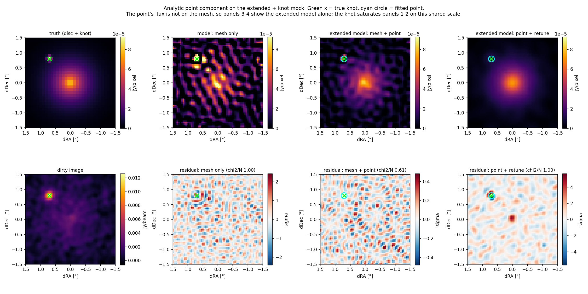

# Analytic point-source components, in full

[← back to the README](../README.md)

A genuine point source is the one thing a pixel grid cannot represent. Its
visibilities are exact and closed-form,

    V(u, v) = A exp(-2i pi (x u + y v))

so the sensible thing is not to put it on the grid at all. `--point-sources`
adds analytic delta components whose amplitudes are solved **in the same
linear system** as the mesh (Schur complement on the augmented normal
equations); only the position is non-linear, and it is refined by a lattice
scan followed by Nelder-Mead. Point fitting itself is opt-in and off
by default; when it is on, the regularisation retune below is on with it.

Why it is worth doing: on the test data a nearest-pixel delta half a pixel
off-centre misrepresents the source at chi^2/N = 31.5, and the best *gridded*
Gaussian still leaves ~1.9 — an error at or above the noise, for a source the
model is meant to describe perfectly.

```bash
pyuvimage fit mydata/ --fov 3.0 --point-sources          # auto-detect
pyuvimage fit mydata/ --fov 3.0 --point 0.70,0.80        # you supply it
```

A supplied position is kept and refined.

**Detection is a matched filter, not a peak finder.** The obvious approach —
take the brightest pixel of the residual dirty image — fails, and it took a
written-products run to expose how badly: the mesh fit has by construction
been driven to chi^2 = N and has already absorbed much of the compact source,
so what is left in the residual is sidelobe structure. On one mock that gave
five "sources" spread over half an arcsecond, four of them with *negative*
flux, and the real 0.012 Jy knot missed entirely. Instead, every trial
position on the product grid is asked the right question — how far would the
fit improve if a point were added *here*, with the mesh free to re-adjust —
which the Schur elimination answers in closed form for one extra column:

    a_j = r_j / s_j,   Var(a_j) = 1/s_j,   s_j = C_jj - b_j^T M^-1 b_j

That is one BLAS call per chunk over the whole field, and it already accounts
for the mesh's ability to mimic a point. Candidates then have to survive:

| guard | what it prevents |
|---|---|
| positive amplitude only | a delta patching a residual trough; a negative "source" is not sky |
| minimum separation 0.75 x beam | several deltas stacking inside one beam and splitting one feature between them |
| **unresolved test** | a delta being recruited to absorb a *resolved* feature |
| significance > 5 sigma (default) | fitting noise |

The unresolved test is the important one. A Gaussian also has an analytic
visibility, so the candidate can be refitted with its width free: an
unresolved source gains nothing, a resolved one gains a lot. Without it, a
plain exponential disc — no point source at all — yields **five** spurious
"detections" at 9-14 sigma, all within 0.2" of the centre, carrying 5.3% of
the flux. They are absorbing the disc's central cusp, which the smoothed mesh
cannot render. With it, the same data yields none:

```
candidate at dRA 0.045", dDec 0.041" rejected: resolved
    (a 0.161" sigma Gaussian fits better by delta chi2 = 147.5)
```

whereas a real knot passes with nothing to gain from widening:

```
point source accepted at dRA 0.702", dDec 0.796": 0.01204 Jy
    (26.3 sigma, unresolved: widening gains only delta chi2 = 0.0)
```

Measured on the extended + knot mock (600 visibilities, mesh 32, `gibbs`;
truth: 0.040 Jy disc + 0.012 Jy knot at dRA 0.700", dDec 0.800"):

| | chi^2/N | peak residual | knot flux | position error |
|---|---|---|---|---|
| mesh only | 1.00 | 2.42 sigma | — (smeared into the mesh) | — |
| mesh + point | 1.00 | 5.67 sigma | 0.01180 +- 0.00024 | 0.004" |
| control: disc only, auto-detect | 1.14 | 11.1 sigma | no point accepted | — |



**Re-tuning the regularisation (on by default; `--no-point-retune` disables it).** The
strength is chosen by the discrepancy principle with the compact flux forced
through the mesh. Once a point carries it, the mesh has freedom it no longer
needs and the combined fit lands below the target — chi^2/N = 0.61 on this
mock, the signature of a mesh now fitting noise. The retune re-imposes
chi^2 = N by stiffening the prior (here by 8e6, coefficient 6.2e3 -> 5.1e10),
which is the same regime the *disc-only* control independently optimises to.

**It re-tunes on the criterion the search used.** Until Sep 2026 the retune
ran only under `discrepancy`. On a large dataset `auto` picks `structure`
(chi^2 is flat there: 0.99995-1.00076 over twelve decades of the coefficient
on one 1.8e7-datum field), so nothing re-tuned, and the delivered prior was
the one the *mesh-only* search chose -- tuned to let the mesh chase the
point's residual. With the point carrying that flux the mesh then fits noise:
structure ratio 0.40 on the real field, 0.14 on a mock of it. Worse, the
split between the point and the mesh under it is set by a prior too weak to
set anything: on a small mock a true 12 mJy point came back at **-86 mJy**,
the mesh carrying the difference. Under `structure` the retune now brings the
structure ratio of the combined (mesh + point) residual to 1 -- on that mock
by a factor of ~8700, recovering 12.5 mJy. A coefficient fixed with
`--lambda` is the user's and is not re-tuned (nor, now, re-optimised on the
adaptive refit, which it silently was).

*Known limitation.* The retune scales one global strength until the *whole*
residual map reads as noise, and that can be met by moving the misfit rather
than removing it. On a mock of a 10 mJy point on diffuse emission with two
narrow streamers: under `adaptive` the retuned fit leaves a +-5 sigma ring
around the point and the flux comes out 8.5 +- 1.4 mJy; under `matern` the
point is exact (9.97 +- 0.07 mJy) but the streamers, narrower than the beam,
sit in the residual at +-4 sigma. Before the retune both fits were overfit
(structure ratio 0.16). Look at `residual.fits` around the point.

**Positions you supply are checked too.** They are kept whatever their
significance, but a component that comes back *negative* is dropped with a
warning, and one that a Gaussian fits better (the same unresolved test
auto-detection applies) is flagged: its flux is then split between the point
and the mesh by the prior, not the data. On mocks a negative component at a
user position is the signature of a resolved compact source -- the mesh
describes it and overshoots slightly at its centre -- and it stays negative at
every prior strength. See `claude/central-point-mock-reproduction.md`.

| | extended model | knot flux (truth 0.01200) | peak residual |
|---|---|---|---|
| mesh only, no point | striped by beam sidelobes at +-5e-5, half the disc's peak | knot smeared into the mesh | 2.42 sigma |
| point, `--no-point-retune` | mottled at +-1e-4, i.e. fitting noise | 0.01204 +- 0.00046 | **0.48 sigma** |
| point + retune (**default**) | smooth and disc-like | 0.01180 +- 0.00024 | 5.67 sigma |

Compare panels 2-4 of the figure against the truth in panel 1: the retuned
model is much the closest, and the striping in the mesh-only panel is what a
prior tuned around an unmodelled compact source costs.

**Point flux errors.** `flux_error_jy` is the amplitude's statistical 1σ,
sqrt of the diagonal of S⁻¹ with S = C − Bᵀ(F+H)⁻¹B: the amplitude's
curvature once the mesh beneath it is allowed to trade flux with it, at the
delivered prior strength. Detection significance is flux over this error.
With `--uncertainty bayesian` each point also gets `flux_bayesian_jy` and
`flux_error_bayesian_jy`: the amplitude's mean and 1σ marginalised over the
prior strength, from the same evidence-weighted mixture as the extended model
(`PointAugmentedFit.bayesian_posterior`; the evidence is that of the joint
mesh + point system, `AugmentedSystem.log_evidence`).

**How far to trust them.** On a single point beside a smooth disc (the demo
S/N series, true 4 mJy) the statistical pulls are 1.4–1.7 at every S/N and the
Bayesian ones 0.2–1.0: the evidence prefers a weaker prior, which leaves the
point its own flux. Where a point sits *on* extended emission neither is
honest. On the generalisation mocks (below) pulls of 4–22σ remain in both:
the posterior on λ is only 0.04–0.08 dex wide there, and how the flux is
shared between a point and the mesh under it is decided by the prior's
*shape*, which no error at fixed shape can see. Read point fluxes on extended
emission as model-dependent at the 5–40% level. (Until Oct 2026 a fixed
±0.5 dex variation of λ was added to the error by hand, which brought those
pulls under 3; it was removed with the prior-systematic uncertainty mode, as
an uncalibrated heuristic — see uncertainty.md.)

Point components appear in `point_sources.json` with positions, fluxes and
1 sigma errors; in `model.fits` as flux dropped into the nearest pixel (the
grid cannot hold a sub-pixel delta, so that file is flux-correct but
positionally quantised); in `model_reconvolved.fits` placed analytically at the fitted
sub-pixel position; and in the header as `NPOINTS` and `PTFLUX`. The mesh
uncertainty map is marginalised over the point amplitudes,
`Cov = M^-1 + (M^-1 B) S^-1 (M^-1 B)^T` — ignoring the second term would
understate the error wherever a point competes with the mesh for flux.

**On the sparse (w-tilde) inversion.** The bordered system needs two things
from the mesh: the cross-terms `B = A^T W P` between the mesh columns and the
point columns, and `A s` for the model visibilities. Both used to be read off
`inversion.operated_mapping_matrix` — the dense `n_vis x n_mesh` build — which
is why `--point-sources` forced `--inversion dense` (21.6 GB on Ruby CO(7-6)
against a 0.10 MB kernel: asking for both gave up the whole point of sparse).

Neither actually needs the matrix. `A = F M`, the real-space mapping matrix
followed by the Fourier transform, so

    A^T W P = M^T Re(F^H (w_re Re(P) + i w_im Im(P)))
    A s     = F (M s)

— the first is the *dirty image of the point column* projected onto the mesh,
one adjoint transform per column; the second is one forward transform of one
image. `pointsource.SparseMesh` does exactly that, and `pointsource.DenseMesh`
keeps the old stacked-matrix route for the dense path. They agree to 5e-16 on
the cross-terms and 7e-14 on the forward direction.

The amplitudes then differ between the two paths at ~5e-7 relative, which is
*not* the backends disagreeing: `F + H` has a condition number around 1e10 (the
mesh has pixels the uv coverage barely constrains), so a 1e-16 difference
anywhere reaches the amplitudes at ~1e-6. Perturbing the dense cross-terms
randomly by the same 5e-16 moves them roughly ten times *further*, which is
what `test_the_difference_is_conditioning_not_error` asserts.

The detector needed one thing more. It scores a trial point at every pixel of
the image grid, and one adjoint transform per trial is the wrong price —
measured at 1e5 visibilities, 1.3 s x 2304 lattice positions is 50 minutes.
But a trial position on a pixel centre is a delta on the grid, so

    b_j = A^T W P_j = M^T F^H W F e_j = M^T W~ e_j

and the whole lattice at once is `(W~ M)^T`: the kernel applied to the mesh's
few hundred mapping columns rather than to the lattice's few thousand, in one
batched FFT. 2400x faster, agreeing with the exact route to 1.6e-14. It
inherits the kernel's `sigma_re == sigma_im` assumption — which the sparse
inversion's own `F` already makes — and a lattice that is not on the grid
declines it and falls back. It is only the detector: accepted positions are
refined and solved through the exact per-column route.

**Streaming works too (MFS).** A point column is an analytic function of uv,
but all three of its terms are values of two image-plane functions the
streaming pass can accumulate once — the kernel K(lag) = sum w cos(2 pi u.lag)
and the data's dirty image Dd(x):

    B_p = M^T k_p,  k_p[i] = K(x_i - p)      C_pq = K(p - q)      Dp_p = Dd(p)

and a Gaussian width is a convolution of K or Dd with that Gaussian. The pass
accumulates both on grids 8x finer than the image (type-1 NUFFTs, so the
extra cost is ~2x the plain pass, not the 50x a per-chunk DFT would be), and
`streamed_points.StreamedAugmentedSystem` reads them with a quintic spline:
2e-9 of K(0), so on 1.8e7 chi^2 the refinement and the unresolved test see
the same surface. The kernel grid reaches a quarter-field beyond one field
width of lag so widened columns near the edge do not read the circular wrap.
Pinned against the in-memory system: identical detections, positions within
Nelder-Mead's own tolerance, fluxes to 1e-6. On a Teresa-sized field (112x112
image, 3136 mesh pixels) a new trial position costs 60 ms and a full scan
4-10 s, in under 2 GB. Cube mode with points still runs in memory.

The in-memory point stage on her 9.1M samples took 2 h 13 min. Part of that
was `cross_on_grid`: autoarray transforms all 3136 mapping columns in one
call, ~5 GB of FFT transients — more than her laptop had. It is now built in
batches (same numbers to rounding), on both paths.

**Limits.** The amplitude covariance is conditional on the prior, so a point
sitting on bright extended emission has an error bar that is only as good as
the prior's description of that emission. Detection has no look-elsewhere
correction: 5 sigma is per trial position, not per map. And the resolved-vs-
unresolved threshold (delta chi^2 = 9) was set on mocks, not on real data.

## Points only (`--points-only`)

No mesh, no prior: the model is `V = sum_k a_k exp(-2 pi i (x_k u + y_k v))`
(`pointonly.py`). The fluxes are linear and profiled out exactly
(`a = C^-1 Dp`, with `C` and `Dp` the point columns' Gram matrix and data term:
from the visibilities in memory, from the oversampled kernel and dirty image
when streamed; the two agree to 1e-8 in chi^2). Positions are searched:

- **given** (`--point x,y`): kept, refined unless `--fixed-points`;
- **detected**: the most significant positive peak of the profile-likelihood
  significance map on the image grid (the accepted points' fluxes re-fitted at
  every pixel), refined (sub-pixel scan, then Nelder-Mead), kept if its flux
  clears `--point-significance`, up to `--max-points`, at least 0.75 beams
  apart; points that a later one leaves below the cut are dropped.

**Uncertainties** are statistical. With free positions: the inverse Fisher
matrix of the full chi^2 in (flux, y, x), `cov = 2 H^-1`, the Hessian by
central differences (exact in the fluxes, which enter quadratically). With
fixed positions: `C^-1`. Both are multiplied by `max(1, chi^2/N)` when the
points do not describe the data to the noise -- a source that is not a point,
or one not modelled -- as for the mesh fits. Over 60 noise realisations of a
two-point mock (27 and 92 sigma) the pulls (estimate - truth) / error have
widths 0.88-1.07 and means within 0.17 for both fluxes and both positions.

Outputs: `point_sources.json` (and `fit_parameters.json`) with, per point,
the offset from the image centre and from the phase centre, RA/Dec through
the products' WCS, flux and errors, the primary-beam response at the position
and the PB-corrected flux (when the dish diameter is known), and the full
covariance; `model.fits` (each flux in its nearest pixel), `model_reconvolved
.fits` (the points restored with the fitted beam), `dirty_image.fits`,
`residual.fits` (sigma) and `summary.png`. MFS only.

### Gaussian components (`--gaussian`)

User-given only: `--gaussian x,y` (start at half the beam), `x,y,fwhm` or
`x,y,fwhm_major,fwhm_minor,pa` [arcsec, degrees east of north], repeatable.
An elliptical Gaussian of flux F and covariance S has the visibilities
`F exp(-2 pi i u.mu) exp(-2 pi^2 u^T S u)`, with
`u^T S u = s_maj^2 u_maj^2 + s_min^2 u_min^2`, `u_maj = v cos PA - u sin PA`,
`u_min = u cos PA + v sin PA` (the major axis turned from north toward east).

Everything is fitted jointly -- each Gaussian's flux, position, ln s_a,
ln s_b and theta, and each point's flux and position (held with
`--fixed-points`) -- by trust-region least squares
(`scipy.optimize.least_squares`) on the noise-weighted visibility residual,
with an analytic Jacobian (pinned against finite differences). Errors:
`(J^T J)^-1` at the solution (the Gauss-Newton inverse Fisher matrix) times
`max(1, chi^2/N)`; reported as FWHM major/minor and PA with their errors
(the axes are swapped and PA moved by 90 deg if the fit turns the minor axis
into the major), and the full covariance in `point_sources.json` in the
fitted parameters (labelled).

Points are detected as well only with `--point-sources`: the Gaussians are
fitted first, points searched with their geometry held (their fluxes
re-fitted), then everything refitted together; a detected point that falls
below `--point-significance` once the Gaussians are free again is dropped.

Measured on an elliptical Gaussian (FWHM 0.6" x 0.3", PA 30 deg, 10 mJy)
plus a 3 mJy point, drawn in the image plane with the PA written out by hand,
under a 0.5" beam, started round, too small and shifted: over 50 noise
realisations the pulls of all nine parameters have widths 0.87-1.10 and means
within 0.22. `model.fits` holds each Gaussian integrated over the pixels and
`model_reconvolved.fits` each one convolved with the restoring beam (flux to
1e-3); `summary.png` draws their FWHM ellipses.

**Is it resolved?** CASA's imfit flags a component it cannot deconvolve
from the beam as consistent with a point (`ispoint`) and gives upper limits
from the largest of the deconvolved sizes over the eight combinations of
size and PA shifted by their errors. Here the size is already intrinsic, but
its Fisher errors are wrong exactly where the question is asked (a size of
zero is a boundary), so each Gaussian is tested by likelihood ratio, every
other parameter of every component re-fitted each time
(`pointonly.resolution_test`):

| `resolved` | test (Delta chi^2 / inflation) | limit reported |
|---|---|---|
| `possibly unresolved` (the likelihood cannot tell it from a point) | point -> Gaussian < 9 | `fwhm_upper_limit`: circular FWHM where chi^2 is 2.71 above the point fit (95%, one-sided) |
| `possibly unresolved along the minor axis` | line (minor axis 0) -> Gaussian < 9 | `fwhm_minor_upper_limit` the same way |
| `yes` | both >= 9 | -- |

Whether a size below the beam can be measured depends on the source's S/N
*and* the observation's uv coverage; the likelihood ratio carries both, so no
rule in beam fractions is applied.

`delta_chi2_vs_point` and `delta_chi2_vs_line` are reported, and
`summary.png` draws an unresolved or one-axis Gaussian's ellipse dashed.
Calibrated on mocks (a 92 sigma source under a 0.7" beam, 60 and 40 noise
realisations): for a true point, Delta chi^2 over a point has median 0.6,
95th percentile 4.7 and 99th 7.9 (none of 60 called resolved); a 0.05"
Gaussian was called possibly unresolved every time with limits (median 0.11") above
the truth in 40 of 40; a circular 0.15" Gaussian was resolved along one
axis (34 of 40) or both (6), and its minor-axis limit covered the truth in
97%.

**Is the fit good?** Two different questions, two statistics. *Which of two
nested models* (point or Gaussian): the chi^2 difference, which is the
likelihood ratio -- the noise of the visibilities that see no source cancels
in it, so it is the most sensitive test there is. *Does the model describe the
data at all*: chi^2/N is a poor judge with many visibilities (it is
dominated by the ones that only see noise, sigma(chi^2/N) = sqrt(2/N)), so
every components-only fit also reports the residual map's **structure ratio**
(`fit_quality.structure_ratio`, with its noise sigma), and warns when it is
more than 3 sigma above 1.

It is measured **within two restoring-beam FWHM of each component** (plus half
a Gaussian's major FWHM; `STRUCTURE_RADIUS_BEAMS`). Components-only fits are
meant for compact sources, and empty sky far from them would dilute the
residual left at the source; the whole-field value is kept as
`structure_ratio_field`. Two details make the local value calibrated:

- its noise sigma comes from the region itself: the residual of pure noise is
  correlated like the dirty beam B, so the mean square over the region has
  variance 2 sum_pq m_p m_q B(p-q)^2 / n^2 (m the region mask, n its pixels),
  one convolution of the mask with B^2;
- each fitted parameter absorbs one independent piece of the noise near the
  components, so for a right model the ratio is divided by
  sqrt(1 - k / n_eff), with k the fitted parameters and n_eff = 1 / (2
  sigma^2) the independent noise values in the region. Over 30 realisations
  of the Gaussian + point mock (9 parameters, n_eff ~ 63) the raw ratio was
  0.923 +- 0.071 against 0.926 expected; corrected, 0.997, and 0.987 for the
  two-point mock. The predicted sigma is ~20% conservative.

On the mock above with the Gaussian wrongly fitted as a point, as the noise
grows (excess over noise in units of each statistic's own sigma;
`scripts/figure_structure_vs_chi2.py`):

| noise | chi^2/N | structure ratio | Delta chi^2, point -> Gaussian |
|---|---|---|---|
| 1 mJy | +348 sigma | +101 sigma | 44215 |
| 4 mJy | +20 sigma | +51 sigma | 2732 |
| 8 mJy | +3.7 sigma | +24 sigma | 672 |
| 16 mJy | -0.3 sigma | +8.6 sigma | |

The right model gives -1.6 and -0.3 sigma. The errors are still scaled by
chi^2/N only.

Limits: in memory only (the streamed grids would need an anisotropic
smoothing of the oversampled kernel per trial shape); a Gaussian's
primary-beam correction uses the PB at its centre; a source with no
measurable size is still fitted at a size that noise alone pushes above
zero (a 270 sigma point: 0.069 +- 0.015"), so read `resolved` before the size
-- that point is reported as possibly unresolved (Delta chi^2 5.3) with FWHM <
0.052".
